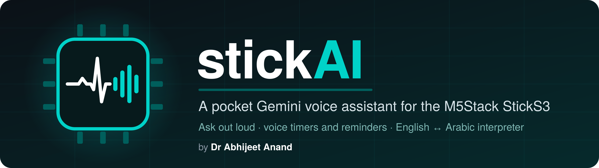
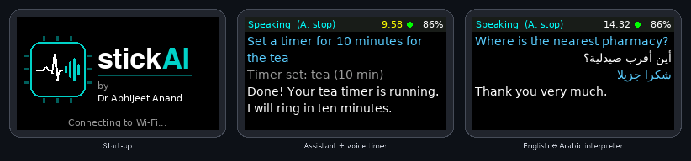
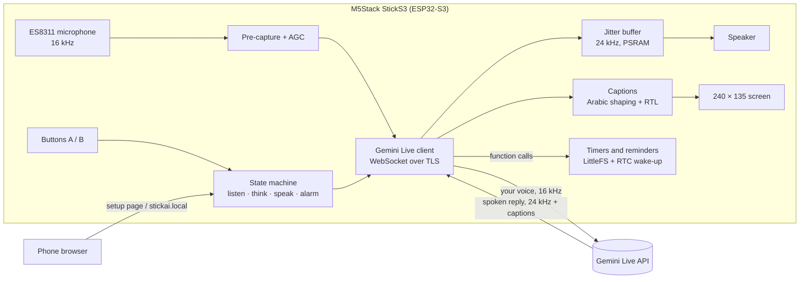

<p align="center">
  
</p>

<p align="center">
  <a href="https://theintensivist.github.io/stickAI/"></a>
  <a href="https://github.com/theintensivist/stickAI/releases/latest"></a>
  <a href="LICENSE"></a>
</p>
<p align="center">
  
  
  
  
</p>

# stickAI

**A thumb-sized AI you can talk to.** Hold a button, ask anything, and Google's Gemini answers out loud through the StickS3's speaker, with its words scrolling across the screen as live captions. Ask it to time your tea or remind you to call home, and it sets the timer itself. Hold the other button and it becomes an **English ↔ Arabic interpreter** you can hand to the person in front of you.

stickAI runs entirely on the thumb-sized M5Stack StickS3. There is no server, no phone app and no subscription: it talks straight to the **Gemini Live API** on Google's free tier. Installing takes one click in your browser, and setup takes about three minutes with your phone.

<p align="center">
  
  <br><sub>Screens simulated from the stick's own font, layout and colours.</sub>
</p>

## Highlights

- 🎙️ **Real conversation, not commands.** Push-to-talk with Gemini's native audio: natural spoken answers, streamed as they are generated, with on-screen captions of both sides. Follow-up questions within 45 seconds keep their context.
- ⏱️ **Voice timers and reminders.** *"Set a timer for 10 minutes for the tea"*, *"Remind me tomorrow at 8:30 to renew the parking"*, *"What timers do I have?"*, *"Cancel the tea timer"*. Gemini calls the stick's own timer functions, so timers ring **without internet**, survive restarts, and even wake the stick from deep sleep.
- 🌍 **English ↔ Arabic interpreter.** Speak English and hear clear Modern Standard Arabic; speak Arabic and hear English. Arabic is drawn properly on the tiny screen: joined letters, right-to-left, numbers the right way round.
- 📱 **No app needed.** First setup uses a QR code and a Wi-Fi page on your phone. Afterwards, a PIN-protected page at `stickai.local` lets you change settings and cancel timers from the sofa.
- 🔒 **Private by design.** The microphone only listens while you hold a button. Your API key is never in this repository or in the firmware: you type it on the setup page and it stays on your stick.
- 💸 **Free.** Gemini's free tier, open-source firmware, no cloud of your own.

---

## Contents

1. [What you need](#what-you-need)
2. [Install the firmware](#install-the-firmware) (four ways, from one click to building from source)
3. [First setup](#first-setup-about-3-minutes)
4. [How to use it](#how-to-use-it)
5. [Privacy and safety](#privacy-and-safety)
6. [Troubleshooting](#troubleshooting)
7. [How it works](#how-it-works)
8. [Build from source](#build-from-source)
9. [Project structure](#project-structure)
10. [License and credits](#license-and-credits)

---

## What you need

| | |
|---|---|
| **Hardware** | An [M5Stack StickS3](https://docs.m5stack.com/) (ESP32-S3, 8 MB flash, 8 MB PSRAM, built-in microphone, speaker and 1.14″ colour screen) and a USB-C cable that carries data, not just power. |
| **A computer** | Windows, macOS or Linux with **Chrome** or **Edge**, used once to install the firmware. |
| **A Gemini API key (free)** | 1. Go to **[aistudio.google.com/apikey](https://aistudio.google.com/apikey)** and sign in with a Google account.<br>2. Click **Create API key**.<br>3. Copy the key. It starts with `AIza`.<br>**Do not add billing or a card to that Google Cloud project.** Without billing, the key can never cost you money. |
| **Wi-Fi** | A 2.4 GHz network (home Wi-Fi or a phone hotspot) with normal internet access. |

---

## Install the firmware

Pick **one** of these. Option A is the easiest.

### Option A: one-click install in your browser (recommended)

1. Connect the StickS3 to your computer with the USB-C cable.
2. Open **[theintensivist.github.io/stickAI](https://theintensivist.github.io/stickAI/)** in **Chrome** or **Edge**.
3. Click **Install stickAI**, pick the stick's port (often named *USB JTAG/serial debug unit*) and click **Connect**.
4. Click **Install**.
   - **First install:** tick **Erase device** for a clean start.
   - **Updating later:** leave it unticked. Your Wi-Fi, API key, timers and reminders are kept.
5. When it says the installation is complete, press the stick's power button once to restart it.

> **Stick not found?** Try another cable, close any serial monitor that might be using the port, or put the stick in **download mode**: hold the power button until the green light blinks, then let go, and click **Install stickAI** again.

### Option B: flash a single file in the browser (no install)

Use this if the installer page above is unavailable.

1. Download **`stickai-full.bin`** from the [latest release](https://github.com/theintensivist/stickAI/releases/latest) (or from [`docs/firmware/`](docs/firmware/)).
2. Open **[espressif.github.io/esptool-js](https://espressif.github.io/esptool-js/)** in Chrome or Edge.
3. Click **Connect** and choose the stick's port.
4. Set **Flash Address** to `0x0`, choose `stickai-full.bin`, and click **Program**.
5. Restart the stick with its power button.

`stickai-full.bin` is a complete image and **clears saved settings**. To update without losing settings, flash **`stickai.bin`** at address **`0x10000`** instead.

### Option C: command line (esptool)

```bash
pip install esptool

# Fresh install (complete image, clears settings)
python -m esptool --chip esp32s3 --baud 921600 write_flash 0x0 stickai-full.bin

# Update (keeps Wi-Fi, API key, timers and reminders)
python -m esptool --chip esp32s3 --baud 921600 write_flash 0x10000 stickai.bin
```

esptool finds the port by itself. Add `--port COM5` (Windows) or `--port /dev/ttyACM0` (Linux) if you have several devices connected.

### Option D: build and flash from source (PlatformIO)

See [Build from source](#build-from-source).

---

## First setup (about 3 minutes)

1. After installing, the stick shows the **stickAI** start-up screen, then a **QR code**.
2. Scan the QR code with your phone's camera to join the Wi-Fi network **`stickAI-Setup-XXXX`**. The password is shown on the stick.
3. A settings page opens by itself. If it doesn't, open **http://192.168.4.1** in your phone's browser.
4. Fill in:
   - **Main Wi-Fi:** your home Wi-Fi name and password.
   - **Backup Wi-Fi** (optional): your phone's hotspot, for use away from home.
   - **Gemini API key:** paste your key.
   - **About you** (optional): a sentence Gemini should know, for example *"My name is Sara and I live in Dubai."*
   - Leave the rest as it is for now.
5. Tap **Save and restart**. The stick joins your Wi-Fi and shows **Hold A to talk**.

Now **hold A and say "Hello, can you hear me?"**

To change settings later, use the [phone page](#phone-page) or **hold B while switching the stick on**.

---

## How to use it

### Buttons

| Do this | What happens |
|---|---|
| **Hold A**, speak, let go | Gemini answers out loud, with captions on the screen |
| **Press A** while it is speaking | Stops the answer so you can ask something else |
| Ask again within about 45 seconds | It remembers what you were just talking about |
| **Hold B**, speak, let go | **Interpreter:** English is spoken back in Arabic, Arabic in English |
| **Tap B** | Scroll back through the conversation |
| **Double-tap B** | Menu: *Timers and reminders*, *Phone page*, *Mic test* (A = next, B = open) |
| **Hold B while switching on** | Open the setup page |
| Power button, double-click | Switch off |

### Timers and reminders

Hold **A** and just ask:

- *"Set a timer for 10 minutes for the tea."*
- *"Remind me at 7 pm to call home."*
- *"Remind me tomorrow at 8:30 to renew the parking."*
- *"What timers do I have?"* or *"Cancel the tea timer."*

The top bar shows the next timer counting down in yellow. When a timer rings: **A = snooze 5 minutes, B = stop**. Timers are saved on the stick, keep working without internet, and wake the stick from sleep when they are due. To review or cancel them, double-tap **B** and open **Timers and reminders** (hold **A** for 2 seconds to cancel the highlighted one), or use the phone page.

### English ↔ Arabic interpreter

Hold **B**, say a sentence in English and let go: the stick speaks it in Arabic and shows the Arabic text. Hand the stick over and the other person holds **B** and speaks Arabic: it answers in English. In this mode it only translates; it does not answer questions.

### Phone page

When your phone is on the **same Wi-Fi** as the stick:

1. Double-tap **B**, press **A** until **Phone page** is highlighted, then press **B**.
2. Scan the QR code, or open **`http://stickai.local`**.
3. Sign in with the username **`stickai`** and the **6-digit PIN** shown on the stick.

From there you can see and cancel timers and reminders, change any setting (saving restarts the stick) and download the last recording.

### Mic test

Double-tap **B**, open **Mic test**, then hold **A**, speak normally and let go. The stick shows how loud you were and plays your voice back. Aim for 10–90 %. If it sounds distorted, tap **B** to change the boost: it counts up to 9, then wraps back to 1 (the default is 9 because the StickS3 microphone is quiet). Hold **B** to go back.

### What the screen shows

- **Top bar:** what it is doing (*Hold A to talk*, *Listening…* in green, *Interpreter: speak* in purple, *Thinking…* in yellow, *Speaking* in cyan), the time or the next timer's countdown, a Wi-Fi dot and the battery level (`+` while charging).
- **Conversation:** your words in light blue, Gemini's in white, short notes such as *Timer set: tea (10 min)* in grey. A small arrow in the corner means you have scrolled back.

---

## Privacy and safety

- **The microphone only listens while you hold A or B.** Nothing is recorded at any other time.
- **Free-tier data use:** on Gemini's free tier, Google may use your conversations to improve its products. **Don't say confidential, personal or medical information** (for example, patient details) to the stick.
- **Your API key** is entered on the setup page and stored only in the stick's internal memory, which is not encrypted. It is never compiled into the firmware or stored in this repository. If you lose the stick, delete the key at [aistudio.google.com/apikey](https://aistudio.google.com/apikey) and create a new one. Because the project has no billing, a stolen key cannot cost you money.
- **Secure connections:** the stick checks Google's TLS certificate against root certificates built into the firmware before sending anything.
- **Setup Wi-Fi** uses a random password, and the phone page is protected with a random 6-digit PIN.
- **It only talks.** It doesn't control devices, open doors or buy anything.

---

## Troubleshooting

| You see | Try this |
|---|---|
| **No Wi-Fi** | Hold B while switching on and re-enter the Wi-Fi name and password. Use 2.4 GHz; on an iPhone hotspot, turn on *Maximize Compatibility*. |
| **Google rejected the API key** | Paste the key again on the setup page. Check that it starts with `AIza`. |
| **Model … not found** | Google renamed the model. On the settings page, set **Model** to the current Live model name shown in Google AI Studio. No reflashing needed. |
| **Free daily limit reached** | Wait for the daily reset at midnight US Pacific time (about noon in the UAE, 11:00 during US daylight saving). |
| **Could not open a secure connection to Gemini** | The Wi-Fi has no internet or blocks this kind of connection (some office or hospital networks do). Try your phone's hotspot. |
| **Gemini said: …** | That is Google's own reason for closing the session. If it isn't clear, [open an issue](https://github.com/theintensivist/stickAI/issues) with a photo of the screen. |
| **No reply to your voice** | Run the **Mic test** and adjust the boost until your voice plays back clearly. |
| **It replies, but there's no sound** | Raise the volume in settings, or charge the stick. |
| **Replies stop after choosing a voice** | Set **Voice** back to **Default** in settings. |
| **Battery shows 0 % or it restarts while speaking** | Charge it with USB-C. A nearly empty battery makes Wi-Fi and sound unreliable. |
| **Start again from scratch** | In settings, tick **Erase all settings** and save, or reinstall with **Erase device** ticked. |

To see the stick's log, connect it by USB and open a serial monitor at 115200 baud (for example `pio device monitor`).

### Limits

- **Screen:** the 1.14″ screen fits about five lines of conversation; answers are kept short, and you can tap B to scroll back.
- **Captions:** the screen font covers English and Arabic. Gemini can speak many other languages, but their letters may not show on screen.
- **Bluetooth headphones** can't be used: the StickS3's chip only has Bluetooth Low Energy.
- **Volume** is capped at 190 out of 255, because very loud playback on battery can cause restarts.
- **Battery:** Wi-Fi and the speaker use the most power. The stick goes to deep sleep after 5 idle minutes (adjustable) and wakes for timers.

---

## How it works



### Engineering highlights

- **True push-to-talk on the Live API.** Gemini's automatic voice detection is switched off; the stick marks each turn itself with `activityStart` / `activityEnd`. Recording begins the instant you press a button, **before** the secure connection is ready, so your first word is never cut off. The session stays open for 45 seconds afterwards for instant follow-ups.
- **Streaming audio both ways.** Microphone audio goes up as 16 kHz PCM; Gemini's voice comes back as 24 kHz PCM into a 45-second PSRAM jitter buffer that only plays whole blocks and re-buffers when it runs dry, so slow Wi-Fi causes a short pause instead of crackle. Input and output transcriptions arrive alongside the audio and become the live captions.
- **Automatic gain control.** The StickS3's microphone is quiet. A fast-attack, slow-release AGC (up to 8×) brings speech to a steady level, and the codec's power-up click is muted, so Gemini hears you clearly at arm's length.
- **Gemini function calling for timers.** The assistant session declares `set_timer`, `set_reminder`, `list_timers` and `cancel_timer`. The firmware executes them, works out times in your time zone, stores them in LittleFS with atomic writes, and programs the ESP32-S3's RTC to wake from deep sleep 4 seconds before the next alarm.
- **Arabic on a 1.14″ screen.** A custom 285-glyph anti-aliased font (DejaVu Sans, converted with [`tools/make_vlw.py`](tools/make_vlw.py)) plus on-device Arabic shaping (initial, medial, final and isolated letter forms, lam-alef ligatures) and right-to-left line layout that keeps numbers and Latin words in the right order.
- **App-free setup.** A captive-portal Wi-Fi network with a QR code and a random password for first setup; afterwards an mDNS name (`stickai.local`) and a PIN-protected page on your home network.
- **Plain-language errors.** When Gemini closes a session, the stick reads the close reason and checks the key and model with a separate request, so you see *"Google rejected the API key"* or *"Free daily limit reached"* rather than a code.

---

## Build from source

You need [PlatformIO](https://platformio.org/) (the VS Code extension or `pip install platformio`).

```bash
git clone https://github.com/theintensivist/stickAI.git
cd stickAI
pio run -t upload        # build and flash over USB
pio device monitor       # optional: watch the log (115200 baud)
```

Build details:

- Platform `espressif32@6.12.0` (Arduino core 2.0.17), board `esp32-s3-devkitc-1` with `qio_opi` memory and the `default_8MB.csv` partition table.
- Libraries: M5Unified and M5GFX 0.3.0, ArduinoJson 7, and a lightly patched copy of arduinoWebSockets in [`lib/`](lib/arduinoWebSockets).
- `WEBSOCKETS_MAX_DATA_SIZE` is raised to 512 KB because Gemini can send large audio messages.

Releases are built automatically: pushing a tag such as `v0.11.0` runs [`.github/workflows/release.yml`](.github/workflows/release.yml), which builds the firmware from this source, checks that no API key slipped into it, and publishes the files on the Releases page.

To make the same files yourself after building:

```bash
B=.pio/build/m5stack-sticks3
BOOT_APP0=~/.platformio/packages/framework-arduinoespressif32/tools/partitions/boot_app0.bin
esptool.py --chip esp32s3 merge_bin -o stickai-full.bin \
  --flash_mode keep --flash_freq keep --flash_size 8MB \
  0x0 $B/bootloader.bin 0x8000 $B/partitions.bin 0xe000 $BOOT_APP0 0x10000 $B/firmware.bin
cp $B/firmware.bin stickai.bin
```

The default model is `gemini-3.8-live`. You can change it on the settings page without rebuilding.

---

## Project structure

| Path | What it does |
|---|---|
| [`src/main.cpp`](src/main.cpp) | Buttons, states (listen, think, speak, interpreter, alarm), menus, sleep and wake-up |
| [`src/live.cpp`](src/live.cpp) | Gemini Live API client: session setup, audio turns, transcripts, function calls |
| [`src/audio.cpp`](src/audio.cpp) | Microphone capture with AGC, speaker playback with jitter buffer, beeps |
| [`src/timers.cpp`](src/timers.cpp) | Timers and reminders, saved on the stick (LittleFS) |
| [`src/ui.cpp`](src/ui.cpp) | Start-up screen, status bar, captions, menus, QR codes |
| [`src/arabic.cpp`](src/arabic.cpp) | Arabic letter shaping and right-to-left layout |
| [`src/font_ar.h`](src/font_ar.h) | Smooth English and Arabic screen font (generated) |
| [`src/portal.cpp`](src/portal.cpp) | First-setup Wi-Fi network and settings page |
| [`src/web.cpp`](src/web.cpp) | Phone page on your home Wi-Fi (`stickai.local`) |
| [`src/net.cpp`](src/net.cpp) | Wi-Fi, clock and connection checks |
| [`src/settings.cpp`](src/settings.cpp) | Settings stored in the stick's NVS memory |
| [`src/certs.h`](src/certs.h) | Root certificates used to verify Google's servers |
| [`docs/`](docs/) | The browser installer page and ready-to-flash firmware |
| [`tools/make_vlw.py`](tools/make_vlw.py) | Converts a TrueType font into the screen font |
| [`.github/workflows/release.yml`](.github/workflows/release.yml) | Builds and publishes release firmware when a version tag is pushed |

---

## License and credits

stickAI is released under the **[MIT License](LICENSE)**. © 2026 Dr Abhijeet Anand.

It stands on excellent open-source work: M5Unified and M5GFX, ArduinoJson, arduinoWebSockets, the ESP32 Arduino core, ESP Web Tools and the DejaVu fonts. See [THIRD_PARTY_NOTICES.md](THIRD_PARTY_NOTICES.md) for their licenses.

Gemini is a trademark of Google LLC; M5Stack and StickS3 are trademarks of M5Stack Technology Co., Ltd. stickAI is an independent project, not affiliated with or endorsed by either.

<p align="center">
  <b>Designed and built by Dr Abhijeet Anand</b><br>
  <sub>A critical care physician who builds with an engineer's mindset.</sub>
</p>
